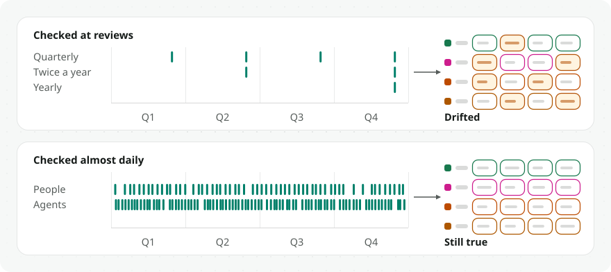

# Uno Blueprint

Get your human and AI teammates on the same page.

An open-source toolkit for context engineering: a canvas for your team, a harness for your agents. One service blueprint that people read as a canvas and agents read as structured data.

[Website](https://uno-blueprint.netlify.app) · [Try the demo](https://uno-blueprint.netlify.app/demo/) · [Agent guide](https://uno-blueprint.netlify.app/uno-blueprint.md) · [Changelog](./CHANGELOG.md) · [Latest release](https://github.com/BilLogic/uno-blueprint/releases/latest)

## Your context is everywhere. Your agents need a map.

<picture>
  <source media="(prefers-color-scheme: dark)" srcset="./docs/assets/why-now.dark.svg">
  
</picture>

MCP connects your agents to your tools, and search finds the passages that match. The blueprint adds how they fit together, so your agents find the right context the first time.

A blueprint lays one service out step by step, by who does the work, and links every cell to the sources behind it. Your docs stay in their tools. The blueprint organizes what they hold and links back.

## How a blueprint is laid out

Service > phase > scenario > path. One path is one blueprint: a grid of lanes (one actor each: the customer, frontstage, backstage, support and others) and steps. Where a lane meets a step, one cell holds the detail: owner, status, value, dependencies and the sources behind it. The full model is in [guide/01 — The blueprint model](./docs/guide/01-the-blueprint-model.md); the specification is [references/data-model.md](./references/data-model.md).

## Quick start

One command writes a workspace, installs it, and prints the lines that start the canvas. It needs Node 22 or later, and no database to start.

```bash
npm create uno-blueprint@latest
cd uno-blueprint
npm run dev
```

The canvas opens on http://localhost:5173 with a sample blueprint. Other package managers work the same way:

```bash
pnpm create uno-blueprint   # then: cd uno-blueprint && pnpm dev
yarn create uno-blueprint   # Yarn 1 (Classic); then: cd uno-blueprint && yarn dev
bun create uno-blueprint    # then: cd uno-blueprint && bun dev
```

Yarn 2 and later, the folder name, `--no-install` and the other options are in [SETUP.md § 1](./SETUP.md#1-start-a-workspace) and [the initialiser's README](./packages/create-uno-blueprint/README.md).

Then add the skills to the coding agent you already use. In Claude Code:

```bash
claude plugin marketplace add BilLogic/uno-blueprint
claude plugin install ub@ub-marketplace
```

That installs the skills as slash commands, in any project. Cursor and Codex find them in `.agents/skills/`, and any other agent routes through `AGENTS.md`: see [guide/03 § In other coding agents](./docs/guide/03-the-plugin.md#5-in-other-coding-agents).

To work on the template itself, clone it instead:

```bash
git clone https://github.com/BilLogic/uno-blueprint.git
cd uno-blueprint
npm install
npm run dev
```

## Example requests

Once the skills are installed, ask your coding agent in plain words:

- Read the docs in this folder and draft a blueprint of our checkout. List what you could not find.
- Who owns payment retries in checkout? Cite the cell.
- What breaks if we add a guest checkout? Change nothing yet.
- Audit the checkout blueprint: steps with no owner, conflicts, stale sources.
- Cut the support team's lane out of the checkout blueprint for a new hire.

## What's inside

### A canvas for your team

A React app (Vite, [shadcn/ui](https://ui.shadcn.com/), Tailwind v4). See how your whole service works, keep it accurate together, weigh one path against another, and tailor it for every stakeholder.

### A harness for your agents

Four skills teach your agents to build the map from your docs, keep it accurate, and test changes against it. Agents draft, check and suggest. Drafts need sign-off before they land.

| Skill | What it does |
| --- | --- |
| [`ub:map`](./skills/map/SKILL.md) | Draft a blueprint from your docs. |
| [`ub:slice`](./skills/slice/SKILL.md) | Cut a view for one audience: a journey, lane, step, cell or custom set. |
| [`ub:audit`](./skills/audit/SKILL.md) | List gaps, conflicts and stale sources, ranked by what to fix first. |
| [`ub:whatif`](./skills/whatif/SKILL.md) | Trace a change before you make it. |

How each skill works, and the agents and hooks around them: [guide/03 — The plugin](./docs/guide/03-the-plugin.md).

### One blueprint, every place you work

- **In the app.** Ask the built-in agent and watch it point at the blueprint. Sign in and bring your own model key.
- **With your coding agent.** In the terminal or the editor: Claude Code, Cursor, Codex.
- **In your team Slack.** A bot on the same blueprint answers where questions are asked, and flags gaps to whoever owns that part.
- **On your phone.** Take the blueprint with you. Read any journey and jump to any step.

## Add a database

The canvas runs on its sample blueprint until your team is ready to share one. Your blueprint then lives in your own database. Supabase is the reference setup and works as shipped:

```bash
cp .env.example .env
npm run supabase:start       # local stack (Docker)
npm run supabase:reset       # applies migrations + sample seed
npm run dev
```

Copy `API URL` and `anon key` from the CLI output into `.env`, then run `npm run check:target`: it asks the database which schema it carries, because a page that renders does not prove the migration ran. Keep every key and connection string in `.env`, never in a tracked file. Who can read what, table by table: [SETUP.md § Who can read what](./SETUP.md#who-can-read-what).

A hosted project, the exposure note table by table, any other Postgres host through the portable core, what stays yours to bring, and deploying: [SETUP.md § Adopting it for a team](./SETUP.md#adopting-it-for-a-team).

## Going deeper

| Guide | Who it is for | What it covers |
| --- | --- | --- |
| [01 — The blueprint model](./docs/guide/01-the-blueprint-model.md) | Anyone reading or authoring a blueprint | What each part of a blueprint is, down to one cell and a slice |
| [02 — Using it in practice](./docs/guide/02-using-it-in-practice.md) | The designer or PM fitting it into their week | What a team does with it, day to day |
| [03 — The plugin](./docs/guide/03-the-plugin.md) | The adopter installing it, the engineer extending it | How the skills and agents work, and what lands on disk |
| [04 — Operations](./docs/guide/04-operations.md) | Whoever runs it | Who may do what, and what happens when it changes |

Every other document is in [INDEX.md](./INDEX.md); the checks to run before pushing are in [SETUP.md § Before you push](./SETUP.md#before-you-push), every guard CI runs is in [docs/engineering/checks.md](./docs/engineering/checks.md), and the repo map is in [docs/overview.md](./docs/overview.md#the-repository-at-the-top-level).

## Credits

Built by Bill Guo and Meryem Marasli. MIT license: see [LICENSE](./LICENSE).
