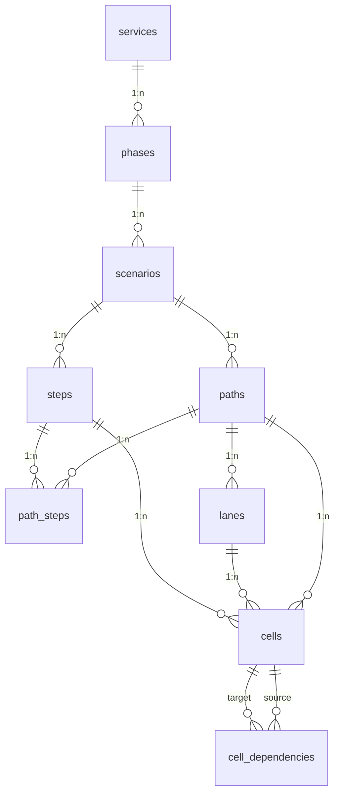

# Database

Postgres database managed by [Supabase](https://supabase.com/) for the **Uno Blueprint** template.

| Property | Value |
| --- | --- |
| **Engine** | PostgreSQL 17 |
| **Primary schema** | `public` |
| **Migrations** | `supabase/migrations/` (consolidated schema, then the migrations that add the records about the board) |
| **Seed data** | `supabase/seed.sql` (generated sample content) |
| **ERD diagram** | `docs/erd.mmd` |
| **The two halves** | `supabase/generated/portable-core.generated.sql` and `supabase/generated/supabase-recipe.generated.sql` — generated from the `-- @recipe` / `-- @core` marks in the migrations by `npm run generate:portable-core`, never hand-edited. The core is the contract and applies to a stock Postgres; the recipe is how Supabase enforces it. CI applies both. See also [`docs/connectors/backend-contract.md`](../backend-contract.md) |
| **The schema dump** | `supabase/generated/portable-core.schema.sql` — what a stock Postgres holds after replaying the core, with only current names; regenerated by `npm run generate:portable-schema` and diffed in CI |
| **TypeScript types** | `src/types/database.ts` |

## Connection (application)

| Variable | Description |
| --- | --- |
| `VITE_SUPABASE_URL` | Project API URL |
| `VITE_SUPABASE_ANON_KEY` | Public anon key (**Settings → API**) |

Without these variables the app runs in **no-DB mode** from the generated
fallback content in `src/data/` — no database required.

## Stand up your own copy

The whole deployer path, for someone who has not read the rest of this file:
clone, create an empty Supabase project, set the two values above, replay the
schema and the seed, and confirm your content shows up. Nothing here needs
Docker or a local database — a hosted project is enough.

1. **Clone and install.** `git clone <your fork>` then `npm install`.
2. **Create an empty project** at [supabase.com](https://supabase.com/), then
   `supabase link --project-ref <your ref>` (the CLI ships as a dev dependency,
   so `npx supabase …` works with no separate install).
3. **Replay the schema — the migrations, in order.** `supabase db push` applies
   every file in `supabase/migrations/`. That IS the core and the recipe: the
   two generated `supabase/generated/*.sql` files are what those same migrations
   build, split into the portable half and the Supabase half, and CI proves the
   split matches. You apply the migrations; you read the generated halves.
   Push onto the project as it was created — do not change its default
   privileges first. The chain is rehearsed in CI against the defaults a
   hosted project carries (§ [A fresh hosted project](#a-fresh-hosted-project)).
4. **Load the seed.** `supabase db execute --file supabase/seed.sql --linked`.
   Out of the box that is the **META-BLUEPRINT** — the blueprint of this
   template itself (see [§ Sample seed](#sample-seed)), so the board is never
   empty on first load.
5. **Set the two values.** Copy the **Project API URL** and **anon key** from
   **Settings → API** into `.env` as `VITE_SUPABASE_URL` and
   `VITE_SUPABASE_ANON_KEY`.
6. **Confirm the content shows up — do not trust the page.** The app falls back
   to bundled content whenever it cannot reach the project, so a database that
   was never migrated renders exactly like a working one. Run `npm run
   check:target` (§ [Did the migration run](#did-the-migration-run)): it asks
   the live target, over the same anon key the app uses, whether it was actually
   migrated.

**Replacing the sample with your own content.** The seed is regenerated from a
blueprint file, never hand-edited: run `python3 scripts/generate_seed_sql.py
<your blueprint>.json --locale <tag>` to emit a transactional seed, replace
`supabase/seed.sql` with it, and repeat step 4. A deployment built on this
template carries its own blueprint and regenerates both `supabase/seed.sql` and
the offline fallback from it — the sample here is only the default until you do.
`ub:map` (the `map` skill) is the guided way to produce that blueprint file.

**Proving the path before you deploy.** `npm run check:seed-load` performs this
whole load — core, recipe, and seed onto a throwaway database — and reads it
back as the anon key, so you can confirm a seed renders before it is anywhere
near a real project. Point it at your own seed by replacing `supabase/seed.sql`
first. It is the same guard CI runs on every change; it needs a reachable
Postgres and permission to create a database.

## Entity relationship (Service Blueprint)



The full attribute-level ERD (with enums and the `lane_role` vocabulary) is
in [`docs/erd.mmd`](../../erd.mmd).

## Hierarchy

| Level | Table | Ordering |
| --- | --- | --- |
| Service Service | `services` | — |
| Phase | `phases` | `position`; optional `loops_to_phase_id` |
| Service Scenario | `scenarios` | `position`; `layout` for layout |
| Path | `paths` | `kind` is `happy`, `variant` or `exception`; optional `note` for path-level context |
| Blueprint row | `lanes` | `position` (per path); `lane_role` semantic key |
| Blueprint column | `steps` | canonical per `scenario` |
| Path column order | `path_steps` | `position` per `(path_id, step_id)` |
| Cell | `cells` | unique `(lane_id, step_id, position)` per path; slot 0 default, tech-lane touchpoints occupy 0..n |
| Cell dependency | `cell_dependencies` | unique `(source_cell_id, target_cell_id, kind)`; `kind`: trigger \| needs |
| Touchpoint | `touchpoints` | the deployment's registry; unique `(name)` across the whole deployment (ADR 0003); `kind` is `app`, `document`, `physical`, `channel`, `service` or `other` |
| Touchpoint placement | `cell_touchpoints` | `touchpoint_id` into the registry OR `name` alone (`cell_touchpoints_one_identity`); unique `(cell_id, touchpoint_id)` and `(cell_id, lower(name))`; owns the summary and role for that moment — what it points at is `resources` rows carrying its id |
| Resource | `resources` | every row carries its cell; a placement's carries `cell_touchpoint_id` as well, held to the placement's cell by a composite key |

**Naming note:** DB table `steps` are blueprint **columns** (journey moments), not service phases. Phases live in `phases`.

**Cascade deletes:** Deleting a service removes phases, scenarios, paths, lanes, steps, path_steps, cells, and cell dependencies. Deleting a phase removes its descendants.

**Path integrity:** `cells.path_id` must match `lanes.path_id`, and `cells.step_id` must appear in `path_steps` for that path (trigger `cells_validate_path_match`). Import order: `paths → steps → path_steps → lanes → cells → cell_dependencies`.

**Shared steps:** Multiple paths under the same scenario can reference the same `steps.id` via `path_steps` with different `position` values. See [`references/data-model.md`](../../../references/data-model.md).

## Lanes (`lane_role`)

A lane's display name (`lanes.name`) is free-form in any language; the
semantic key `lanes.lane_role` drives rendering (touchpoint cells, storyboard
rows, divider-line anchoring), and the set is closed by `lanes_lane_role_check`:

| Role | Rendering |
| --- | --- |
| `customer_actions` | Spine actor lane — the **interaction line** draws after it |
| `frontstage_actions`, `frontstage_touchpoints` | Frontstage lanes — the **visibility line** draws after them |
| `backstage_actions` | Backstage lane — the **internal interaction line** draws after it when a `support_actions` lane follows |
| `frontstage_touchpoints`, `backstage_touchpoints` | Cells render as multi-item **touchpoints** (newline-separated content) |
| `support_actions`, `partner_actions` | Text cells (support and partner lanes) |
| `storyboard` | Storyboard frame rows |
| `null` | Generic swimlane (actor lanes; the role set is closed, so there is no custom role) |

Frontend contract: `src/lib/laneRoles.ts`.

## Cells

Each cell sits at a **lane × step** intersection for one path.

| Column | Required | Description |
| --- | --- | --- |
| `content` | yes (default `''`) | **Cell Label** — primary text shown in the blueprint grid |
| `frame` | no | Optional image URL or storage reference |
| `summary` | no | Optional longer summary (detail panel; not the grid label) |

### What a cell points at, and the touchpoints placed on it

Both were one `links` JSONB array until `21000113000000`, which split it into
two tables because it held two unrelated things under a name that described
one of them.

`touchpoints` — the deployment's registry:

| Column | Required | Description |
| --- | --- | --- |
| `name` | yes | The identity: unique across the whole deployment, so a second service reuses an entry by naming the same tool the same way. Placements match it case-insensitively |
| `kind` | yes (default `other`) | `app` \| `document` \| `physical` \| `channel` \| `service` \| `other` |
| `summary` | no | What this touchpoint IS, for the deployment |
| `url` | no | Where the touchpoint itself lives |
| `stakeholder_id` | no | The actor who owns this touchpoint, into the deployment's cast — null when nobody has said yet, which is how the sync mints one. An actor taken out of the cast un-names its touchpoints (`on delete set null`) rather than being refused, the same rule `lanes.stakeholder_id` runs on |

`cell_touchpoints` — one touchpoint, used at one cell:

| Column | Required | Description |
| --- | --- | --- |
| `cell_id` | yes | The cell this touchpoint is used at |
| `touchpoint_id` | one of these two | The registry entry this placement names |
| `name` | one of these two | The touchpoint's name when the registry lacks it — a **name-only placement**, drawn dashed. `cell_touchpoints_one_identity` holds exactly one of the two set; linking to the registry clears it |
| `position` | yes | Author order within the cell |
| `summary` | no | Prose about this touchpoint at THIS moment |
| `role` | no | `core` \| `peripheral` — whether the moment happens through this touchpoint or it is merely present. Null = nobody has judged it, and renders nothing |

Six structural writes, SECURITY DEFINER behind `is_service_account()`, five
since `21000120000000`: `sync_cell_touchpoints` follows a cell's text (a new
line mints a registry row and a placement; a line that left keeps its writing as
a name-only row, or goes), `restore_cell_touchpoints` is its inverse,
`set_placement_touchpoint` links a placement to the registry or names it,
`remove_placement` / `restore_placement` take a name-only row off a cell and put
it back, resources included. `rename_touchpoint` (`21000202000000`) is the
sixth: it moves the registry row AND the matching item in every bearing cell's
`content`, in one transaction, because a rename that stopped at the row would be
undone by the next content save. It decides which cells from the placements
rather than from a text search, matches a whole item so renaming `Zoom` leaves
`Zoom Recording` alone (`rename_content_item` is the pure half), and returns the
previous name and the cells it rewrote so a caller can record an inverse that
restores both halves.

A placement's own two columns are written directly rather than through a
function — `summary` and `role`, by placement id — since neither needs a
transaction. `21000119000000` granted `role` to `authenticated` and
`21000202000000` granted `summary`; `cell_touchpoints_update_service_only`
decides who, and the column list decides what.

A placement's design link and screenshots are `resources` rows carrying its
`cell_touchpoint_id` — a featured `link`, and `attachment`s with the first
featured. `21000119000000` copied the `url` and `screenshots` columns there and
dropped them.

`resources` — what a cell points at:

| Column | Required | Description |
| --- | --- | --- |
| `cell_id` | yes | The cell this resource belongs to — always |
| `cell_touchpoint_id` | no | Set as well when a placement owns it — a design link or the image a touchpoint shows at this cell. `resources_placement_in_cell_fkey` is the composite key `(cell_touchpoint_id, cell_id)` onto `cell_touchpoints (id, cell_id)`, so a resource cannot name a placement in another cell |
| `kind` | yes (default `link`) | `link` \| `attachment` — a place on the web, or a file the cell points at |
| `name` | yes | What the thing on the other end is called |
| `url` | yes | Both kinds carry one (`resources_has_url`) |
| `featured` | yes (default `false`) | The resource its owner leads with. One featured attachment per cell and per placement — `resources_one_featured_attachment_per_cell` / `_per_placement` — any number of featured links |
| `position` | yes | Author order within its owner; the cell's own rows and a placement's rows are ordered separately |

Four writes, all SECURITY DEFINER behind `is_service_account()` since
`21000118000000`: `sync_cell_resources` reconciles the cell's own list by id
(a reorder keeps every id) and refuses a placement's rows;
`sync_placement_resources` is the placement's list; `set_featured_resource`
clears the owner's previous featured attachment in the same transaction and
returns the before-states; `restore_featured_resources` writes them back.
`other` became `attachment` in `21000118000000`.

An uploaded file is an `attachment` whose `url` is its object's public URL in
the `cell-attachments` bucket (`21000121000000`, recipe): public read, writes
for the service account only, keys `cells/<cell id>/<object id>.<ext>` — ids
and nothing else, so no rename moves a URL. Deleting the row leaves the
object. `resources_url_absolute` (core) refuses a site-relative path on any
resource; a backend without Supabase keeps files wherever it keeps files and
writes their URLs into the row. The upload helper is `attachmentUpload.ts` in
`src/lib`; the resource list's **Upload a file** and **Replace…** call it, in
the Resources tab and in a touchpoint's group alike.

App types: `CellResource` and `CellTouchpoint` in `src/types/blueprint.ts`.
Reading: `cellResources.ts` and `cellTouchpoints.ts` in `src/lib`.

## Layouts (`scenarios.layout`)

| Value | Behavior |
| --- | --- |
| `stacked` | One full band per path on a shared step axis (`variant_label` names each) |
| `merged` | The paths combined into one blueprint: one lane rail, one step axis, shared cells drawn once |

Two values, stored as the UI names them. The header toggle writes the column
through `update_scenario_layout`, so a scenario left merged opens merged.
`single` became `stacked` in `21000117000000` — one path stacked is one
band, so the value only ever changed which component drew it. `side-by-side`
and `integrated` became `stacked` in `21000116000000`; every row held
`side-by-side` and the other two were unused.

## Sample seed

**The seed is the META-BLUEPRINT: the service blueprint of this template
itself.** Not filler, and not a demo to delete before starting — a first
blueprint that explains the tool it ships with. Replace it with your own
service; until then it doubles as the documentation.

It earns the default three times over. A reader's first blueprint is an
explanation of what a blueprint is. It exercises the compare views,
`loops_to_phase_id`, and three slice kinds, so a broken renderer shows up on
first run rather than after someone imports real content. And **one generator
feeds both adapters** — `scripts/generate_sample_blueprint.mjs` emits the SQL
seed and the no-DB fallback module from the same source, so the no-DB path
serves the same content a seeded database does. That is why "no database" is a
supported mode here and not a degraded one.

`supabase/seed.sql` is **generated** by `scripts/generate_sample_blueprint.mjs`
alongside the offline fallback module (`src/data/sampleBlueprint.ts`): one
`Keeping a blueprint true` service → four phases (`Discover` → `Setup` →
`Operate` → `Maintain`, with `Maintain.loops_to_phase_id` → `Operate`) → six
scenarios carrying eight paths (`happy` and `variant` kinds) on one 7-lane
roster (canonical roles plus a null-role Stakeholders swimlane), plus a
storyboard row on `Map your service` and three demo slices. Sample UUIDs use the
`f0000000-…` prefix. Re-run the generator after editing it — never edit the
emitted files by hand.

Two things exist in this schema but deliberately not in the sample: `evidence`
rows (restricted `SELECT`, so an offline reader could never see them) and the
lane spec columns `kpis` / `tools` / `owner_team`. Neither has a home in the
offline `BlueprintData` shape, and the seed and the fallback module are
required to hold the same content.

## Row Level Security

All blueprint tables have RLS **enabled** with public `SELECT` policies, and
the `anon` role stays read-only: a deployed site can render everything but
write nothing. **Anything you deploy with an anon key is publicly readable.**

Writes are layered on top for signed-in sessions (`authenticated`):

- **Structure goes through RPCs, not tables.** The authoring-operations
  migration ships `SECURITY DEFINER` functions (create/duplicate/rename/
  reorder/delete scenarios, paths, lanes, steps; `upsert_cell`;
  dependencies) — each performs one complete, valid edit in one
  transaction. No table-level `INSERT`/`DELETE` on structural tables is
  granted to app roles.
- **New cell columns need an explicit UPDATE grant.** `cells` carries
  column-level UPDATE grants, including for the service role; a migration
  adding a writable column grants UPDATE on that column explicitly. New
  confirmation columns stay closed unless a guarded RPC owns their writes.
- **Ordinary text edits use column-scoped grants**: `cells.content/
  summary`, `cell_touchpoints.name/position/summary/role`,
  `resources.kind/name/url/position`, `lanes.name/lane_role`, `steps.name`,
  `paths.name/summary/note/kind`,
  `scenarios.name/summary/layout`, plus the spec columns — writable directly by `authenticated` under permissive
  update policies.
- **Optional service-account tier** (`20260818002000`, a recipe you can
  skip or delete): RESTRICTIVE policies AND an in-function
  `is_service_account()` guard split `authenticated` into service accounts
  (edit everything) and regular accounts (view + agent surfaces, no
  blueprint writes). `anon` is untouched either way. Note that
  `supabase db reset` applies every file in `supabase/migrations/`, this one
  included: the split is what you get unless you delete the file.
- **Profile confirmation is an intentional exception to the service-account tier.**
  `approve_suggested_change` and `confirm_cell` allow a caller whose profile
  holds `may_confirm`, including an ordinary account without the service
  claim. Their own guard checks that right before writing; approval records
  the approving login in `authoring_changes`. `record_contribution` requires
  a profile and records evidence and a suggestion, leaving the cell alone.
  `decline_suggested_change` requires may-confirm and leaves the cell alone.
- **A write policy is a PAIR, and this is the one shape.** Per table and per
  verb, a surface table carries a permissive `<table>_<verb>_auth` with
  `using (true)` — *the panels reach this table directly rather than through
  an RPC* — and beside it a RESTRICTIVE `<table>_<verb>_service_only` whose
  predicate is `public.is_service_account()` — *and only the editing tier
  may*. **Write both when you put a table on the write surface.** A single
  permissive policy whose whole predicate is `is_service_account()` admits
  exactly the same people, and is deliberately not used **on the surface**: it fuses the
  optional recipe's decision into a base-template policy — correct only
  because the core seam's default body is `select true`, which nothing at the
  call site shows — and it makes a table whose restriction is *missing*
  (`services`, until `21000212000000`) unreadable from one that never had a
  second half. `21000213000000` brought the last two tables,
  `stakeholders` and `cell_touchpoints`, into the pair; the posture on both
  was already service-account-only and did not change.

  Off the surface the single-permissive spelling survives, and a reader who
  greps for `_service_only` will meet it: `touchpoints` and `resources` carry
  six such policies. Those two are reached only through RPCs
  (`sync_cell_resources`, `set_featured_resource`, `rename_touchpoint`), so
  neither the argument above nor the rule beneath it has been applied to them.
  They admit exactly a service account and are not holes. Whether the pair
  should extend past the surface is undecided rather than answered — this
  paragraph exists so the exception is visible instead of looking like drift.
- **And read it the other way: a restriction with no permissive half is not a
  posture, it is a closed door.** A RESTRICTIVE policy narrows and never
  admits, so a verb carrying one and no permissive policy matches zero rows
  for everyone it names — the same answer RLS already gives a verb with no
  policy at all, bought at the price of reading like governance. **A verb the
  app reaches only through an RPC gets no write policy**, and the empty list
  is the statement: absence means the direct write path is closed.
  `20260818002000` created all three write policies on each of thirteen
  tables whether or not there was a permissive one to narrow, and twenty of
  them, over eleven tables, never had one. `21000214000000` removed those
  twenty and asserts that none is left. No posture moved: `authenticated`
  holds no grant for any of the twenty verbs, so each was refused before row
  level security was consulted, before the change and after it. The rule has
  two halves and both are worth saying — write BOTH policies when you put a
  table on the write surface, and write NEITHER when you do not.
- **The first account a project ever has is a service account**
  (`21000206000000`, part of the same recipe). `service_account_emails`
  ships empty, so without this a fresh deployment of the tier would have no
  editor at all and would need a hand-written `update auth.users` to gain
  one. Every account after the first is governed by the allowlist as
  before. The client reads the tier by CALLING `is_service_account()`, so
  deleting the recipe needs no matching client change — see
  `docs/connectors/backend-contract.md` § Auth contract.
- **Agent-surface tables** (`agent_sessions`, `agent_messages`) are
  reachable only by `authenticated`; the same migration restores the
  findings insert/update grants for in-app agent runs (still ANDed with
  the tier's restrictive policies where applied).

Seeds and migrations still go through the Supabase CLI with your own
credentials.

## Migration history

| File | Description |
| --- | --- |
| `20260716200000_template_schema.sql` | Consolidated template schema: hierarchy + blueprint grid + `lane_role`, integrity trigger, `updated_at` triggers, read-only RLS, legacy `services` cleanup |
| `20260729120000_derived_layer.sql` | The records about the board: `slices`, `slides`, `findings` (open-fingerprint partial unique index), `evidence`, `propositions`, `evidence_counts` view, cell/lane/phase spec columns, `cell_dependencies.kind` |
| `20260730090000_derived_layer_grants_hardening.sql` | Explicit Data API grants, anon write-privilege revokes, pinned `search_path`, attribution columns, evidence `cell_key` pairing |
| `20260803001000_slices_origin_allows_human.sql` | Adds `human` to the `slices.origin` vocabulary (in-app authored slices) |
| `20260818000000_authoring_foundation.sql` | Authoring foundation: `origin` provenance columns, `cells.cell_key` identity, `cells.position` (+ widened uniqueness), deferrable `path_steps` ordering, the deletion archive, direct-column grants for panel edits |
| `20260818001000_authoring_operations.sql` | Authoring operations: the `SECURITY DEFINER` RPCs (create/duplicate/rename/reorder/delete structure, `upsert_cell`, dependencies) that are the only sanctioned write path for structural shape |
| `20260818002000_service_account_tier.sql` | OPTIONAL recipe: splits `authenticated` into service accounts (edit everything) and regular accounts (view + agent surfaces) via RESTRICTIVE policies + `is_service_account()` |
| `20260819000000_agent_surface.sql` | Agent surface: `agent_sessions`/`agent_messages` chat persistence (authenticated-only) and the findings insert/update grants for in-app agent runs |
| `21000101000000_schema_version_is_a_table.sql` | `schema_version`: one row naming the shape this database carries, so the adapter contract's compatibility check can interrogate a live target |
| `21000102000000_a_rewriter_for_function_bodies.sql` | Scaffolding for the vocabulary series: rewrites plpgsql bodies a rename left naming the old identifier (restoring ACLs when a signature change forces a drop), renames dependent objects from the catalog, and asserts the old word is gone. Dropped by `21000109000000` |
| `21000103000000_cell_triggers_are_cell_dependencies.sql` | `cell_triggers` → `cell_dependencies`; `kind` keeps (`trigger`, `needs`) |
| `21000104000000_layers_are_lanes.sql` | `layers` → `lanes`, `layers.layer_role` → `lanes.lane_role`, `cells.layer_id` → `cells.lane_id` |
| `21000105000000_position_columns_one_name.sql` | `row_position` · `column_position` · `slot_position` · `order_position` → `position`; `add_lane(at_row)` → `add_lane(at_position)` |
| `21000106000000_service_lifecycles_are_services.sql` | `service_lifecycles` → `services`, `service_lifecycle_id` → `service_id` on phases, slices, findings, evidence, propositions |
| `21000107000000_service_scenarios_are_scenarios.sql` | `service_scenarios` → `scenarios`, `service_scenario_id` → `scenario_id` on paths and steps |
| `21000108000000_description_is_a_summary.sql` | `description` → `summary` on services, phases, scenarios, paths, cells; `slices.description` keeps its name |
| `21000109000000_the_lane_vocabulary_is_a_schema_version.sql` | `schema_version` → `2026.08.25`; drops the series' scaffolding |
| `21000110000000_the_ir_can_author_a_needs_edge.sql` | `schema_version` → `2026.08.26`. No DDL: `cell_dependencies.kind` has existed since `20260729120000`; the IR gained the field that can author it |
| `21000111000000_propositions_are_the_business_model.sql` | `propositions` → `business_models`, with its constraint, index, policy and trigger names swept from the catalogue rather than listed. `evidence.proposition_question_key` is a permanent exemption and is asserted to survive. `schema_version` → `2026.08.27` |
| `21000112000000_the_word_boundary_left_five_behind.sql` | Repairs what `\m…\M` could not reach. `set_cell_dependency` named `cell_triggers_source_target_kind_unique` in an `on conflict on constraint`, and `21000103`'s catalogue sweep had renamed that constraint — the body rewrite used a word-boundary pattern, and `_` is a word constituent, so it matched the table reference and not the constraint. Plus three stale comments and one inside a function body. No version bump: nothing about the shape moves |

## Reserved migration timestamp band

**Upstream migrations are allocated from `21000101000000`–`21991231235959`.
Nothing else is.** Enforced by `npm run check:band`, on every pull request.

The number is an allocation counter wearing a date's clothes. Take the next
unused day in the band; the file's own header carries the date it was really
written.

### Why a band at all

A fork adds `20260901120000_theirs.sql`, then pulls an upstream migration
stamped with the day upstream wrote it. `supabase db push` applies in timestamp
order, so that upstream file sorts *before* a migration the fork has already
applied — the desync people repair by hand-editing
`supabase_migrations.schema_migrations`.

A band above any wall clock a fork will produce makes the ordering arithmetic
instead of procedural: an upstream migration always sorts after everything the
fork has applied, so a pull can only ever append. In exchange, upstream
migrations must never assume anything a fork built — which is already true of
every migration here, and is now a rule rather than a coincidence.

### The eight that predate the rule

`20260716200000` through `20260819000000` keep their real timestamps. They are
already applied on every database that exists, and renaming an applied migration
*is* the desync this prevents. `scripts/check-migration-band.mjs` freezes them by
name; that list only ever shrinks.

### Adding a migration

1. Take the next unused day inside the band — one migration per day, in order.
   Use the time field when several land in one release.
2. Write the real authoring date in the file header.
3. `npm run check:band`.

## Did the migration run

**The failure this answers**: the app starts, every container reports healthy,
and the database was never migrated. That is the shared failure signature of
every comparable self-hosted project, and a healthy process says nothing about
the schema behind it. Worse here than elsewhere: without a configured project
this app runs its no-DB adapter and renders perfectly, so a misconfigured
target looks exactly like a working one.

So the question gets an answer rather than an inference:

```bash
npm run check:target
```

It asks the live target for `public.schema_version` over the same Data API and
anon key the app uses, and distinguishes three things a rendering page cannot:

| Outcome | What it means | What to do |
| --- | --- | --- |
| `the target carries schema_version …` | Reachable, migrated, compatible | Nothing |
| `has no public.schema_version — it has never been migrated` | The Data API answers, the schema was never applied | `supabase db push`, or `npm run supabase:reset` locally |
| `carries X; this checkout speaks Y` | Migrated, wrong shape | Apply the pending migrations, or check out the revision matching the target |

Reads `.env`, then the environment, then `--url` / `--key`. It is **not** in CI:
CI has no target, and a check that needs a live database is a check that would
be skipped and then trusted.

For the per-migration view — which versions are applied on the remote and which
are still local — the CLI answers directly:

```bash
supabase migration list --linked
```

## The agent account

**The failure this answers**: an agent reads a schema section that was typed
by hand, and a column comment, a type or a panel definition moved underneath
it. The generator splices those two sections from the live catalog and the
code; the check fails when they drift or when column-comment coverage falls.

```bash
npm run agent-account                 # splice docs/agents/blueprint.md
npm run agent-account -- --record    # record the coverage ratchet
npm run check:agent-account            # fail on drift
```

With no database configured (missing `VITE_SUPABASE_*`, or still the
example placeholders) both commands print a skip and exit 0. Nothing is
generated and nothing is registered — the agent's reference list is this
template's own. A deployment that has a database runs the generator, then
supplies the document as `agent.references.blueprint` on its deployment
config (see `references/customization.md`). The template's reference loader
never imports that file by path.

## Ranked search (`search_blueprint`), which this schema does not ship

**The failure this answers**: a person asks the in-app agent "where does a
first-time visitor get stuck?" in their own words and is told nothing matched —
when the moment is mapped, in different words. Every other read this template makes goes through
PostgREST against tables defined here, so it works wherever the template does.
Ranked search does not: it needs a database function this schema has no
migration for.

So the tool is OFF and ABSENT unless a deployment says otherwise, and what a
deployment says lives on its config rather than in a fork of the tool:

```ts
agent: {
  search: {
    enabled: true,
    indexes: [{ provider: 'google', model: 'gemini-embedding-001', dimensions: 768 }],
  },
}
```

`enabled` is a claim about the database, not a preference: it says this
deployment's schema carries `search_blueprint`. With it false or absent the
tool is not on the agent's roster at all — absent, not failing.

### What the function must accept and return

The template calls one function with these arguments, and reads these columns
off each row. A deployment may accept and return more; it may not rename or
drop these.

| Argument | Meaning |
| --- | --- |
| `q` | the words to match |
| `granularity` | which rungs to search: `phase`, `scenario`, `path`, `step`, `lane`, `cell` |
| `match_count` | top-k cut-off |
| `filter_phase`, `filter_scenario`, `filter_path_kind`, `filter_lane_role` | narrowing, all optional |
| `query_embedding` | the question's vector in pgvector text form, sent only when a meaning arm is expected |
| `embed_model` | the model name that vector came from |

| Column | Read for |
| --- | --- |
| `kind`, `id` | what the row is, and the id every later write names |
| `snippet`, `description` | the line the agent shows |
| `phase`, `scenario`, `path`, `step`, `lane` | the breadcrumb |
| `matched_by` | which arm found this row, shown per result |
| `total_matched` | the corpus-wide total, so a top-k answer is not read as the whole set |

EVERY row must carry `phase`, including a phase's own row, which names itself.
That column is how a read confined to one service places a row, because the
function takes no service argument — a row without it cannot be placed and is
dropped. And because `phases.name` is not unique across services, a phase name
two services share places nothing either: those rows are dropped, counted, and
reported, rather than handed to the wrong service. A deployment with several
services is better off giving its phases distinct names.

The function must raise an error whose message contains `embedding model
mismatch` when `embed_model` names a model it holds no index for. pgvector's own
width refusal (`different vector dimensions …`) is read the same way, because a
deployment that lists a size its column does not hold produces a vector the
provider was right to return and the column is right to reject. Scoring a
vector from the wrong space would rank noise and look like a working search;
raising makes a misconfigured index list visible in a deployment's own logs.
The template answers that one error with a single keyword-and-structural retry,
and then tells the model that meaning matching did not run.

### The two keys, and why the index is the deployment's job

Meaning matching needs two vectors in one space: the question's, and every
cell's. They come from different keys, and only one of them is the template's
business.

- **The question** is embedded in the browser with the PERSON's own provider
  key, as `RETRIEVAL_QUERY`, at the model and size the listed index names. The
  key goes to that provider's embedding endpoint and nowhere else — never to
  this database, never into a log, and never into a URL.
- **The cells** are embedded by the deployment's own job with a SERVER-HELD
  credential, as `RETRIEVAL_DOCUMENT`. The template holds no such credential,
  builds no index, and refreshes nothing.

Every listed entry therefore needs an index that already exists, built with
exactly that model at exactly that size, and the document/query task types
above are not interchangeable: swapping them produces an index that scores
plausibly and ranks badly.

Score with COSINE (pgvector's `<=>`), not inner product. Gemini's embedding
models return a normalized vector at their native width and an unnormalized
one whenever a smaller size is asked for — which is every call the template
makes, since an index column is narrower than the model. Cosine normalizes as
it scores and is unaffected; inner product is not, and would rank by vector
length.

Listing no index at all is a supported state, not a half-configured one: the
tool is offered and runs the function's keyword and structural arms. What is
NOT supported is listing an index a person's provider cannot reach and hoping
they get keyword search — those people are not offered the tool, quietly,
because a keyword search presented as the same search everyone else has is
worse than no tool. A person on an Anthropic key is always in that group:
Anthropic has no embedding model.

## Migration desync: the repair

**Who needs this**: forks created before the reserved band existed, whose local
history and the remote's `supabase_migrations.schema_migrations` have diverged.
Inside the band it cannot recur — an upstream migration always sorts after
everything already applied, so a pull can only append.

The symptom is `supabase db push` refusing:

> Found local migration files to be inserted before the last migration on remote database

That is the desync, not a permissions problem and not a broken migration. It
means a local file carries a version earlier than one the remote has already
applied — a pull of upstream work stamped before the fork's own.

**1. See the two histories.**

```bash
supabase migration list --linked
```

`Local` and `Remote` columns; a version in one and not the other is the
divergence. Read it before changing anything — the repair below edits migration
history, and the two directions are not interchangeable.

**2. If the local files are simply pending, apply them out of order.**

An upstream migration stamped before one the fork already applied is still
*correct* — nothing upstream depends on anything a fork built, which is a rule
here and not a coincidence. So the ordinary case needs no history surgery:

```bash
supabase db push --dry-run --include-all   # read what it would apply
supabase db push --include-all
```

`--include-all` applies every local migration the remote's history table does
not list, regardless of where it sorts. Use `--dry-run` first; if the list
contains anything you do not recognise, stop and do step 3 instead.

**3. If the histories genuinely disagree, repair them — per divergent version,
whichever is true.**

- The remote **already has the schema** that migration builds (typical when the
  fork applied it under a different filename, or applied it by hand):

  ```bash
  supabase migration repair --status applied <version>
  ```

- The remote **does not** have it and should get it on the next push:

  ```bash
  supabase migration repair --status reverted <version>
  ```

`repair` writes `supabase_migrations.schema_migrations` and touches no table of
yours. Getting the direction wrong is what makes it dangerous: marking a
migration `applied` that never ran leaves the schema missing whatever it built,
and nothing will try again.

**4. Push, then verify against the target rather than the exit code.**

```bash
supabase db push
npm run check:target
```

**5. Take the band from here on.** Upstream migrations land in
`21000101000000`–`21991231235959` and always sort last, so once local and remote
agree, a pull cannot reintroduce this.

**If the histories are too tangled to reconcile by hand**, the escape hatch is
`supabase db pull` — it writes the remote's actual schema into a new local
migration, which makes the remote authoritative and the divergence moot. The
cost is a migration file that is a snapshot rather than a change, so do it once
and say so in the file header.

## A fresh hosted project

A hosted project is created with default privileges for role `postgres` in
`public` that grant ALL on every new table, function and sequence to `anon`,
`authenticated` and `service_role`, each by name. A stock Postgres grants
none of that, and before v2.8.9 CI replayed the chain on a stock Postgres, so
two proofs passed there and stopped a fresh hosted `supabase db push`:

- `21000116000000` dropped and recreated four RPCs and restored their ACL
  with a `revoke … from public`, which does not take away anon's own grant;
  its proof raised `the drop-and-recreate widened an RPC to anon`.
- `21000214000000` asked an INSERT as `authenticated`; with the platform's
  INSERT grant the row reached `cells_validate_path_match` before row level
  security and raised `cells: lane_id does not exist`.

Both files were corrected in place. That is the one case where editing a
shipped migration is right: the CLI does not re-run a version it has already
recorded, so no database that applied either file will differ, and the edit
matters only where the original raised and rolled back. (The `21000116000000`
loop also drops an `authenticated` or `service_role` grant the recreate landed
on that the captured ACL lacked; a project created under these defaults
captured both, so that changes nothing there either.)
`21000308000000` repairs what the same restore left on databases that did
apply: `add_lane` and `create_phase` executable by `anon`, and a proof that no
authoring write — a `SECURITY DEFINER` function in `public` that guards itself
with `is_service_account()` — is. A definer read a deployment grants to `anon`
on purpose, such as its own `search_blueprint`, is outside the rule.

CI now replays the chain behind `supabase/portable/platform-defaults.sql`, which
stands in those default privileges, and fails if any proof reports it skipped
for want of the role.

**A project pushed with the workaround.** If you got past the two failures by
running `alter default privileges for role postgres in schema public revoke
execute on functions from anon, public` and applying part of `21000214000000`
by hand with `supabase migration repair --status applied 21000214000000`, the
tables, policies and functions you hold are the ones the corrected chain
builds — the skipped part of `21000214000000` is its proof, which writes
nothing. Function ACLs can differ: what was created under the workaround has no
default grant to PUBLIC or `anon`, which a fresh install gives it. Nothing the
app calls depends on that (every RPC anon needs is granted to it by name), and
restoring the default does not change those functions retroactively. Put the
default back so
later migrations meet the project CI rehearses, then push:

```sql
alter default privileges for role postgres in schema public
  grant execute on functions to anon, public;
```

```bash
supabase db push
npm run check:target
```

## Migration authoring notes

Ops lessons this repo carries as rules for anyone adding migrations:

- **REVOKE from PUBLIC on every new write function.** Postgres grants
  `EXECUTE` to `PUBLIC` on function creation, so a freshly created
  `SECURITY DEFINER` RPC is callable by every role until you say
  otherwise. Pair every `create function` with
  `revoke execute ... from public, anon;` and an explicit `grant execute`
  to the roles that should call it — in the same migration. Name `anon`:
  on a hosted project it holds its own grant beside PUBLIC's, and a revoke
  from PUBLIC leaves it. A drop-and-recreate that restores a captured ACL
  revokes every grantee the recreate landed on first, then replays the ACL.
- **A proof that asks as `authenticated` meets the platform's grants.** On a
  hosted project the role holds ALL on every table, so a write is refused by
  a policy or by a BEFORE ROW trigger, not by a missing grant. A proof that
  only accepts 42501 will fail there and pass in a rehearsal without the
  defaults; CI's replay carries them, so write the proof against that.
- **Migration files are committed the same day they are applied** to any
  shared project. An applied-but-uncommitted migration makes the repo lie
  about the shared schema; the next contributor's `db reset` or diff runs
  against a state the migrations directory cannot reproduce.
- **One log records every authoring write, and it has two writers.**
  `public.authoring_changes` is append-only — two triggers refuse UPDATE,
  DELETE and TRUNCATE on it, so the definer functions and the service key
  cannot rewrite it either. The client appends through
  `record_authoring_change`, which takes the operation, its arguments, its
  captured inverse and the author, and takes no payload parameter at all:
  a caller cannot claim to have deleted something. The six delete RPCs
  append their own row, because a destroyed row's payload can only be
  captured inside the transaction that destroys it. `public.trash` is a
  view over the rows that carry a `deleted_kind`, so the recovery list is
  a filter on the record rather than a second table kept in step with it.
  It is AUDIT-ONLY: `revert` is stored so a row can say what would undo
  it, and nothing replays it — `executeRevert` accepts only a branded
  `SessionEntry` that the session stack alone mints.
- **Undo paths couple to insert policies.** Migrations are append-only
  (an undo is a new migration), and client-side undo is policy-coupled: a
  revert that re-inserts a deleted row verbatim (evidence restore is the
  canonical case) works only while the table's INSERT policy accepts
  client-supplied ids and authorship columns. Tightening that policy —
  e.g. adding `with check (created_by = auth.uid())` — silently breaks
  the undo. If the policy must tighten, move the restore into a
  `SECURITY DEFINER` RPC that re-checks authorization and preserves
  authorship server-side, in the same change.
- **RESTRICTIVE policies never bind SECURITY DEFINER RPCs.** Definer
  functions run as the function owner and bypass RLS entirely, so a
  restrictive tier policy on the table gives zero protection against
  them. The guard must be asserted inside the function body — an
  `is_service_account()`-style check raising an exception — in every
  definer RPC that writes.

## Example query (path blueprint)

```ts
const { data } = await supabase
  .from('paths')
  .select(`
    id,
    name,
    kind,
    scenarios (
      id,
      name,
      phases (
        id,
        name,
        position,
        services ( id, name )
      )
    ),
    lanes ( id, name, lane_role, position ),
    path_steps (
      position,
      steps ( id, name )
    ),
    cells (
      id,
      content,
      frame,
      summary,
      lane_id,
      step_id,
      resources!resources_cell_id_fkey ( id, position, kind, name, url, cell_touchpoint_id, featured ),
      cell_touchpoints ( id, touchpoint_id, name, position, summary, role, touchpoints ( name, kind ) )
    )
  `)
  .eq('id', pathId)
  .single()
```

## Key application files

| File | Role |
| --- | --- |
| `src/lib/workflowQueries.ts` | Supabase nested selects |
| `src/lib/normalizeBlueprint.ts` | Raw path row → `BlueprintData` |
| `src/hooks/useCanvasBlueprints.ts` | Load paths + blueprints per scenario |
| `src/data/blueprintFallbacks.ts` | Offline/demo blueprint data |

## Local commands

```bash
npm run supabase:reset             # migrations + seed
npm run generate:database-types    # regenerate src/types/database.ts
```

`generate:database-types` needs a reachable Postgres and permission to create a
database, and nothing else: it stands up the portable core and the recipe on a
fresh database of its own, generates the whole file from that, and drops it.
There is no linked project and no hand-written section to paste back — the enum
unions at the bottom are read off the CHECK constraints that close each
vocabulary. `npm run check:database-types` is the same run, diffed against what
is committed.

## For a deployment: what its own types file is, and what is held to what

A deployment generates its own `types/database.ts` however it does — the
Supabase CLI against its project, or this generator against its own core — and
since a deployment reads the application out of this package, that file is not
what anything compiles. `@/types/database` resolves into the package, and the
application is typechecked against the copy that ships beside it. A
deployment's own file is the DECLARATION of the database its project actually
has: the subject of its live schema check and of `npm run agent-account`.

What is worth holding, then, is the database and not the file. The check asks,
for every table BOTH files describe, whether every column this package's
application reads is described there too:

```bash
node node_modules/uno-blueprint/scripts/check-database-types-superset.mjs \
  types/database.ts
```

It exits 0 when it is, and lists the columns that are missing — and any column
the two files describe so differently that they cannot both be about one
column — when it is not. A missing column on a table the deployment does build
is usually a types file that was not regenerated after a migration.

Two things it deliberately does not fail on:

- **A table this package describes and the deployment does not.** That is a
  migration the deployment has not run, and a deployment is entitled to carry
  the part of this core its service uses. The absent tables are printed as
  information and the exit code stays 0.
- **A column's width.** `string` and a narrowed vocabulary are one text column
  described at two precisions, and `Json` and `NonNullable<Json>` are one jsonb
  column disagreeing about null. Neither side is wrong. `string` against
  `number` is, and that is what the comparison is for.

The enum unions in the tail are not compared. They are this package's aliases,
imported by this package's code, which reads them out of this package's copy
wherever it runs; no `Row` column is typed as one on either side, and the
vocabulary they close is a CHECK constraint — a fact about a database, which
this file is not the place to read it from. The CLI above emits no such tail,
so a deployment following the documented path used to fail here for doing
exactly what it was told.

## Hosted seed

```bash
supabase db execute --file supabase/seed.sql --linked
```

## Pilot profiles on a test project

Run `node scripts/seed-pilot-profiles.mjs --test-project` only after setting
`SUPABASE_PROJECT_REF` in `.env` to the linked test project. Both checks apply
to `--print` too. Copy `supabase/pilot/profiles.example.json` into the ignored
people file. Its optional `stakeholder` overrides the default cast-list name:
use an existing actor's exact name to link them. Reused kinds must fit the role
(consultant: partner; owner: staff or team; expert: staff). Re-running updates
links and names but preserves an operator's may-confirm decision.

## Remote read and write tools

Run `npm ci`, then `npm run build:tool-server` to bundle the shared read and
write roster for the `uno-tools` Edge Function. Dependencies, including
`@supabase/server`, are bundled into the generated server module; no import map is
needed. The build refuses unresolved dependencies and any emitted external
import before writing the bundle, and CI runs that same check. If dependency
resolution fails, run `npm ci && npm run build:tool-server` before deploying.
Deploy with `supabase functions deploy uno-tools --use-api` against the linked
project after applying its migrations. Its platform JWT check is disabled in
`supabase/config.toml`; the handler verifies the caller's JWT with Supabase
Auth's public JWKS on every request and forwards that same token to the
database. It uses the publishable key and never an admin client. RLS applies
to both the session and its transcript. The canvas keeps its browser history
adapter; the server reads a private transcript from persisted rows.

The protected-resource metadata points clients to Supabase Auth. Browser
OAuth additionally requires enabling Supabase's OAuth server and dynamic
client registration, and hosting a consent screen at an agreed frontend URL.
Those settings and that frontend are an operator prerequisite; this tracer
does not provide a consent page or claim to verify a host's OAuth redirect
flow. See [Supabase's OAuth server guide](https://supabase.com/docs/guides/auth/oauth-server).

For a deployed test project, set the `TOOL_SERVER_TEST_EMAIL`,
`TOOL_SERVER_TEST_PASSWORD`, `TOOL_SERVER_OTHER_EMAIL` and
`TOOL_SERVER_OTHER_PASSWORD` aliases in the ignored `.env`, alongside
`SUPABASE_URL` and `SUPABASE_ANON_KEY`. `npm run test:tool-server:project`
signs in both existing people, checks that `tools/list` includes writes and
that an empty phase name is refused, creates a temporary private conversation as
the first, reads it over MCP and proves the second cannot. It also checks a
blueprint read and missing/invalid token refusals, then deletes its temporary
conversation and signs out only its own Auth sessions. It writes no blueprint
or profile rows. It verifies direct JWT authentication; browser consent and
Cursor interaction remain separate checks.

Remote writes pass the shared roster and admission, then `run_agent_tool`.
The database transaction checks the derived tool schema, the applicable IR
field rules and real relationships before committing. Incremental authoring
still permits an empty phase or scenario while it is being built, as the
canvas does; this does not certify a complete IR document for import.
`generate-tool-contracts.mjs` derives the schemas from the definitions and
`references/ir-schema.json`; its drift check requires a forward migration when
an already deployed contract changes. The gateway calls the existing structural
RPCs and applies direct-table edits in the same transaction as their durable
log. Preview runs the same operation in a rolled-back subtransaction.

A write needs a linked profile. Findings and evidence can be recorded freely;
a blueprint change needs a person who may confirm and `confirmed:true` after
that person's explicit yes. Otherwise it becomes a pending row in the existing
`suggested_changes` table. Cell-content contributions keep the Profiles
`record_contribution` path, including evidence in their giver's name; cell-spec
and structural proposals carry the tool name and arguments. Approval checks the
original tool's current admission and schema again, compares the named target
rows with their proposal-time values, and runs the same transaction as a direct
call under the approver's identity. A missing or changed target is a refusal;
the proposal stays pending and nothing is written. List and decline include
both existing cell-content suggestions and general tool proposals.

The durable `authoring_changes` row carries the authenticated caller and, on
approval, `proposed_by` and `approved_by`. This is the minimum attribution
needed for server writes. Each tool transaction also captures the actual
changed rows under `revert: {kind: "captured_rows", rows: [...]}`: every row
names its table and holds `before` and `after` values, with null on the absent
side of an insert or delete. The capture includes RPC side effects such as
placement changes and belongs to the same transaction; a preview rolls it
back with the write. These are prior values for a later undo design, not a
browser `RevertSpec`. No durable row enters the current undo stack, and there
is no server undo action. Existing cell-content approvals keep their captured
cell-update inverse and gain a distinct action label; the canvas records that
action locally without duplicating the database log. The server neither installs
a process-global log writer nor borrows browser agent attribution. Every call is capped at 50 distinct cells, including cells copied
by a path or scenario duplication. The secret check matches the plugin hook's
service-role JWT policy and runs over the whole argument tree, before schema
parsing can discard unknown fields. The Supabase recipe also enforces it in
the transaction; a different host must supply its own checker before writes
can run.
The server's `list_sessions`, `get_session` and `get_change_history` read
`agent_sessions`, `agent_messages` and `authoring_changes` with the caller's
JWT. Conversation reads stay private through RLS; durable change rows are a
business audit and are never presented as replayable undo. `get_profile` reads
only the signed-in person's profile, so an agent host can identify its person
without choosing somebody else's profile id. The canvas retains its browser
history adapter.

References are MCP resources at `uno://references/<name>`, derived from the
same reference definition and names as the canvas tools. The reference tools,
all interface tools, UI-state and UI-command reads are absent from the server
tool roster. Resource reads still require authentication.

A person configures `BLUEPRINT_EMBEDDING_API_KEY` as a Supabase function secret,
with `BLUEPRINT_EMBEDDING_MODEL` and `BLUEPRINT_EMBEDDING_DIMENSIONS` matching
an existing search index; `BLUEPRINT_EMBEDDING_PROVIDER` is `openai` by default
or `google`. The template does not create an index or set those secrets.
Without a key and valid index metadata, ranked search is not offered. With
them, the shared search reader embeds the question using the server key and
forwards only the vector/model to the deployment's `search_blueprint` RPC.
The key is never a tool argument, browser setting, database argument or reply.
The MCP/database test supplies a fixture provider transport; it proves key
handling and the RPC boundary, not a live provider or deployment index.
